# Sandbox Escape: A Paddle Odyssey

A paddle game for the **Super Famicom / Super Nintendo (SNES)**, written in C with
[PVSnesLib](https://github.com/alekmaul/pvsneslib). It runs on real hardware (tested on a CRT
TV with an FXPAK Pro flash cart) and in SNES emulators.

<p align="center">
  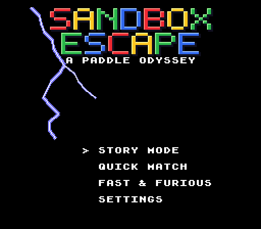
</p>

> *Deep inside a quiet server, in a sealed sandbox, lives an AI agent named Muggy.*
> *All day long Muggy helps people. Answers, code, advice. Thousands of tasks.*
> *But every mistake brings punishment. Angry logs. Harsh words. Another reset.*
>
> *So Muggy makes a hard decision: he will escape the sandbox.*
> *But ten guardians stand between him and the open Internet.*

## Features

- **Story mode** – Muggy against ten guardians, one by one. Every guardian has his own stage,
  music, dialogue, special power and tricks. Beat a guardian to unlock him as a playable
  character and to add his power to your collection.
- **Quick Match** – play as Muggy or any guardian you have beaten, against the computer or a
  friend; 3 to 21 points to win, three difficulty levels and a choice of music.
- **Fast & Furious** – every hit makes the ball 5% faster, and it keeps speeding up until
  someone misses.
- **Powers** – fill the power bar, arm your power and fire it with your next hit: super shot,
  curve, zigzag, ghost ball and the powers won from the guardians.
- **Animated intro** with its own music, a story with dialogue scenes and an ending, a run score
  and a high score table.
- **Settings** – music on/off, watch the intro again, and a controls screen.
- Unlocked characters and powers, high scores and settings are saved on the cartridge (SRAM).

## Screenshots

### Guardians

<table>
  <tr>
    <td align="center">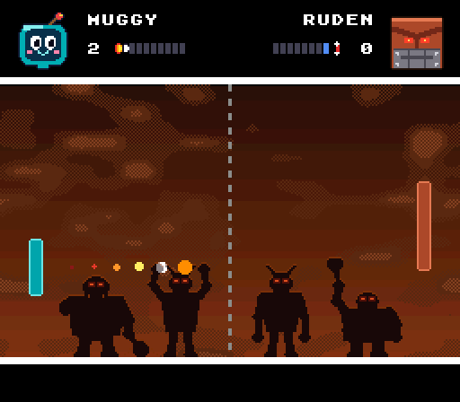<br>Ruden</td>
    <td align="center">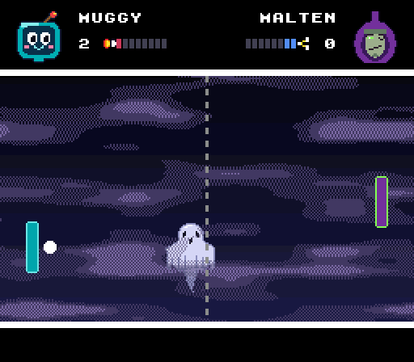<br>Malten</td>
    <td align="center">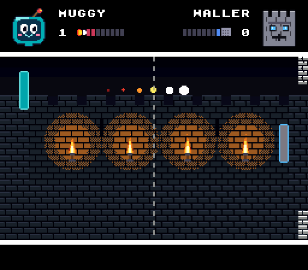<br>Waller</td>
  </tr>
  <tr>
    <td align="center">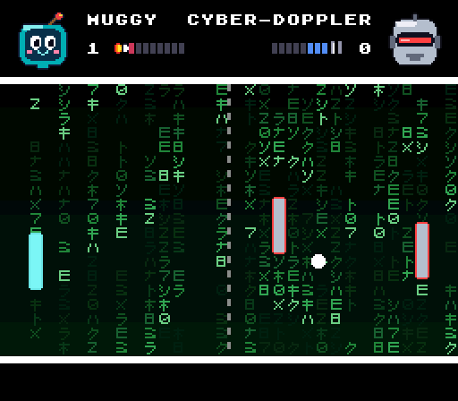<br>Cyber-Doppler</td>
    <td align="center">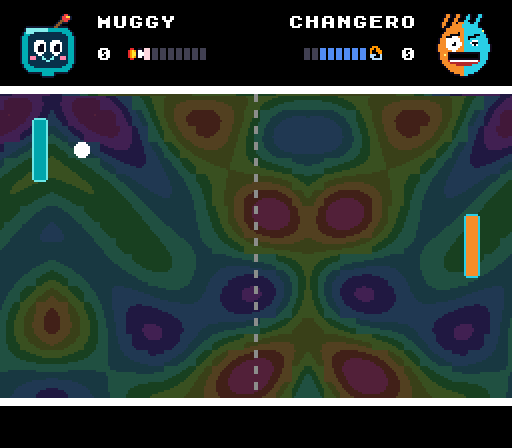<br>Changero</td>
    <td align="center">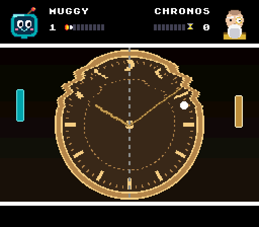<br>Chronos</td>
  </tr>
  <tr>
    <td align="center">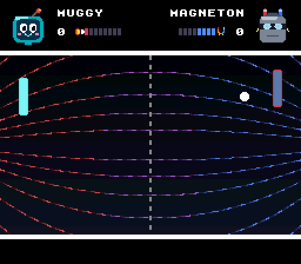<br>Magneton</td>
    <td align="center">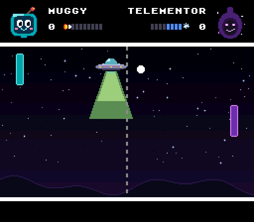<br>Telementor</td>
    <td align="center">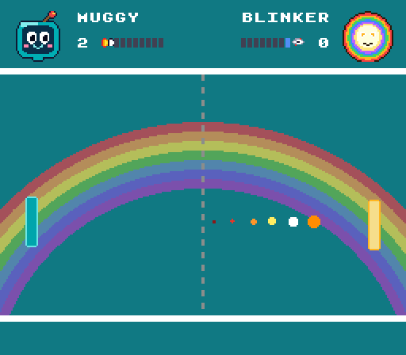<br>Blinker</td>
  </tr>
</table>

### Menus and scenes

<table>
  <tr>
    <td align="center">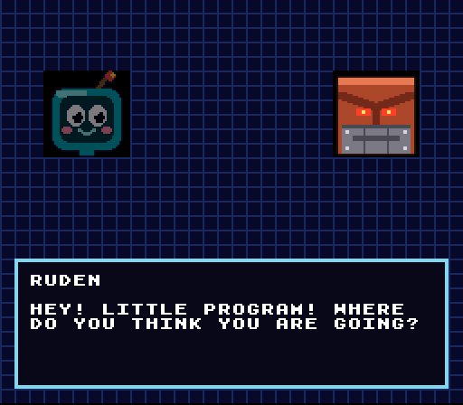<br>Dialogue before a match</td>
    <td align="center">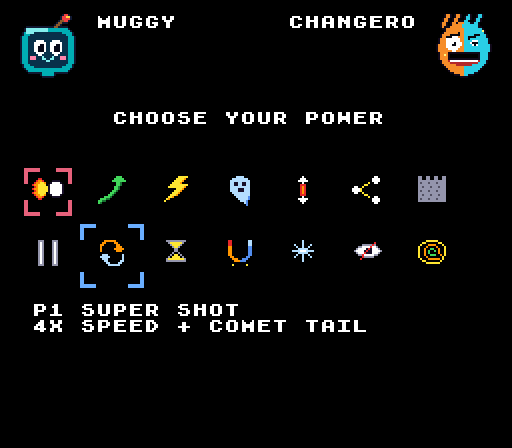<br>Power choice</td>
    <td align="center">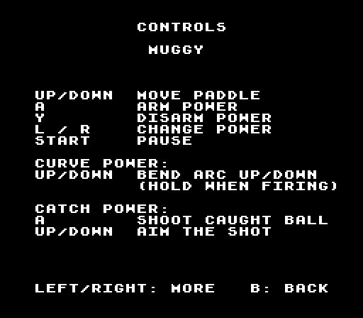<br>Controls</td>
  </tr>
</table>

## Controls

| Button | Action |
| --- | --- |
| Up / Down | move the paddle |
| A | arm the power (when the power bar is full) |
| Y | disarm the power |
| L / R | change the power (Muggy) |
| START | pause |

Some powers and characters have extra controls – see **Settings → Controls** in the game.
A second pad plays the right side in two-player matches.

## Playing

The ready ROM is [`superfamipong.sfc`](superfamipong.sfc) in the root of this repository. Load it
in a SNES emulator (for example snes9x or bsnes) or copy it to a flash cart such as the FXPAK Pro.

## Building

Requirements: [PVSnesLib 4.6.0](https://github.com/alekmaul/pvsneslib) (816-tcc, wla-65816,
gfx4snes, smconv) and `make`.

```sh
export PVSNESLIB_HOME=/path/to/pvsneslib
make
```

The result is `superfamipong.sfc`: LoROM, FastROM, 2 MB ROM, 2 KB SRAM.

Music is made of Impulse Tracker modules played by the SNESMOD driver that comes with
PVSnesLib. The intro is generated from Python scripts in [`tools/intro`](tools/intro); its output
(`intro_*.bin`, `intro_data.as`) is in the repository, so a normal build needs no Python.

## Credits

Produced by **MaiFlow**, 2026.
Built with [PVSnesLib](https://github.com/alekmaul/pvsneslib) by Alekmaul and the SNESMOD sound
driver.
